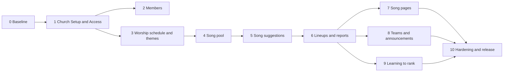

# Development Plan

The build order for CHORD as a worship planning system, following the
[[Concept-Brief]] ([[0005-worship-planning-scope]]). Phases 0 to 2 built
the foundation under the earlier church-administration plan; from Phase 3
on, every phase builds part of the brief.

Tick a task only when its tests and checks pass (see
[[#Definition of done]]). When a phase is finished, update [[00-Home]] and
add a [[Development-Log]] entry.

## Phase order

Each phase builds only on finished phases, so nothing gets built twice.

| Phase | Name                          | Size | Depends on | Status            |
| ----- | ----------------------------- | ---- | ---------- | ----------------- |
| 0     | Engineering baseline          | S    | none       | Done (2026-11-15) |
| 1     | Church Setup and Access       | L    | 0          | Done (2026-11-16) |
| 2     | Members                       | M    | 1          | Done (2026-11-16) |
| 3     | Worship schedule and themes   | M    | 1          | Done (2026-11-17) |
| 4     | Song pool                     | M    | 3          | Next              |
| 5     | Song suggestions              | L    | 4          | Not started       |
| 6     | Lineups and reports           | L    | 5          | Not started       |
| 7     | Song pages: chords and playback | L  | 6          | Not started       |
| 8     | Teams and announcements       | M    | 6          | Not started       |
| 9     | Learning to rank              | S    | 6          | Not started       |
| 10    | Hardening and release         | M    | 7, 8, 9    | Not started       |

This **Status** column is the record of phase progress. Statuses: Done
(with date), In progress, Next, Not started. Sizes are relative
(S < M < L). Phases 7, 8 and 9 don't depend on each other and can go in any
order.

Out of scope since [[0005-worship-planning-scope]]: Giving, Records,
Services (Service Requests), Ministries and Events.

## How each feature is built

Every feature is a **vertical slice**: one complete, usable piece rather
than all models first and all screens later.

1. Read the module note in `03-Modules/` and [[Glossary]]. Settle any new
   term in the glossary first.
2. Write the models and migration. Decide which parts are church settings
   (core rule check, below).
3. Put the business rules in plain functions outside the views, and test
   them directly ([[Code-Conventions]]). Views stay thin.
4. Build the views and templates with the shared mixins (module check,
   permission check, audit trail).
5. Write tests: rules, permissions (allowed and denied), and the
   module-off case.
6. Run the checks script, then update the vault.

### Core rule check (every slice)

From [[0001-configure-behavior-not-identity]]:

- Anything that differs between churches is a setting or a church-edited
  list with neutral defaults.
- Code branches only on settings.
- An unused optional step disappears from both the screens and the
  statuses.
- Wording that differs between churches comes from Labels.
- Denomination, tradition and religion are absent from models, forms, seed
  data and UI text. A guard test enforces this (Phase 0).

### Definition of done

- [ ] `scripts/check.ps1` passes: Ruff lint and format, `manage.py check`,
  no missing migrations, all tests.
- [ ] Permission tests cover every new view, for both allowed and denied
  users.
- [ ] Switching off the module hides it and returns 404 for its pages,
  without losing data.
- [ ] Changes to planning data (services, themes, lineups, songs, teams)
  are in the audit trail.
- [ ] Tests never use the network or download a model: outside services
  and ML models are replaced by stand-ins.
- [ ] The vault is updated: module note, [[00-Home]] status, and a
  [[Development-Log]] entry.

## Conventions

See [[Code-Conventions]]. Update that note whenever a phase settles a
convention.

## Phase 0: Engineering baseline

**Status: done (2026-11-15).**

Goal: a safe, repeatable project setup before any features are built.

- [x] Initialise Git, confirm that `.env` is ignored, and make the first
  commit.
- [x] Create `apps/core` with `TimeStampedModel`, `PublicIdModel` and
  test-data builders.
- [x] Add the base template: page layout, navigation area, messages and
  form styling. Bootstrap 5 and HTMX are stored in `static/vendor/`.
  Record the UI choice as decision 0002.
- [x] Add `scripts/check.ps1`, which runs every check in
  [[Environment-Setup]].
- [x] Add `coverage` to `requirements.txt`.
- [x] Add the **denomination-free guard test**, which fails if
  "denomination", "tradition" or "religion" appears in models, forms,
  templates, fixtures or seed data.

## Phase 1: Church Setup and Access

**Status: done (2026-11-16).** See [[Church-Setup]] and [[Accounts]].

Goal: the configuration layer that every later module relies on.

- [x] **Church Profile** (exactly one per installation): name, address,
  contact details, logo, currency and time zone, with a settings screen.
- [x] **Modules**: a registry in code, on/off settings on the Church
  Profile, `ModuleRequiredMixin` (404 when off), and navigation that shows
  only switched-on Modules.
- [x] **Labels** with neutral defaults, a `` template tag and a
  Python helper.
- [x] **Accounts and Roles**: sign in and out, password change and reset,
  own profile; Roles on Django groups with editable defaults; the
  permission matrix; user management.
- [x] **Audit trail**: a shared `AuditEvent` and `record_change()`, plus
  the audit log screen.
- [x] **Setup wizard**: church details, then Labels, then Modules. It
  never asks for a denomination.
- [x] **Dashboard** with one card per switched-on Module.

## Phase 2: Members

**Status: done (2026-11-16).** See [[Members]].

Goal: the people directory. The brief asks only for a basic one; this is
kept as built.

- [x] Custom Fields in `apps/core`.
- [x] Membership Status and Household Roles as church-edited lists.
- [x] Member and Household, with list, detail, add, edit and archive.
- [x] CSV import with a preview, and CSV export.
- [x] Privacy rules, the own-record page, and the audit trail.

## Phase 3: Worship schedule and themes

**Status: done (2026-11-17).** See [[Worship]].

Goal: the brief's service scheduling and theme intake (pipeline stage 1),
and the scope change itself.

- [x] Re-scope the Module registry, Labels and default roles
  ([[0005-worship-planning-scope]]).
- [x] **Service Template**: a church-edited kind of service with ordered
  **Song Slots**, each with a feel, and an optional usual day and time.
- [x] **Worship Service**: name, template, date and time, rehearsal time,
  notes and a cancelled flag.
- [x] The schedule list (upcoming and past, with search) and a month
  calendar.
- [x] **Schedule weeks ahead**: adds a template's service on its usual day
  for the coming weeks, filling only the gaps.
- [x] **Theme** per service: title, main scripture, notes and an optional
  **Series** (a church-edited list). Notes are shown only to people who
  plan.
- [x] **Attendance**: a headcount per service.
- [x] Default-role permissions, permission tests and the audit trail.

**Done when** a service can be scheduled, given a theme and counted, and
the tests cover weekly scheduling in the church's time zone.

## Phase 4: Song pool

Goal: the songs the system knows, and the outside services and models that
describe them (pipeline stages 3, 5 and 6 as reusable pieces).

- [ ] **Song** (`apps/songs`): Spotify track ID, title, artist, album and
  length; cached lyrics and their status; the worship check result; feel;
  theme tags; an embedding; "the team knows it".
- [ ] **Theme Tag**: a church-edited list of about 30 worship themes with
  neutral defaults. **Trusted Artist**: a church-edited list, empty by
  default.
- [ ] A **Spotify client**: app token, track search with paging and the
  genre filter, and error handling. Credentials come from `.env`.
- [ ] An **LRCLIB client**: lookup by title, artist, album and length, one
  request at a time, with a fallback search.
- [ ] The **ML engine**: sentence embeddings and a zero-shot classifier
  run with ONNX Runtime, plus a keyword stand-in used by every test.
- [ ] **Song analysis**: the worship check, tag suggestions, the feel
  guess and the embedding, from lyrics only.
- [ ] The song library: list with filters, song page, and editing of tags,
  feel, the worship check and "the team knows it".

**Done when** a song's lyrics can be fetched, analysed and corrected by
hand, and the tests run without the network or model files.

## Phase 5: Song suggestions

Goal: from a posted theme to ranked songs (pipeline stages 2 to 9).

- [ ] **Suggestion settings** (one row): search genres, phrases per theme,
  pages per phrase, market, the four ranking weights, and the repeat
  window.
- [ ] **Season**: church-defined date ranges linked to Theme Tags; none by
  default.
- [ ] **Search Run**: phrases used, pages read, songs found, run time,
  progress and status.
- [ ] The pipeline: search phrases, Spotify search with the unfiltered
  retry, cleanup, lyric lookups, analysis of new songs, ranking and
  explanations.
- [ ] Ranking: `w1·relevance + w2·familiarity + w3·season − w4·recency`
  over every accepted song in the pool.
- [ ] Sequencing: the top songs placed in the template's slots by feel.
- [ ] The **search worker** (`manage.py run_worker`) and a progress panel
  on the service page.
- [ ] A way to try the pipeline without Spotify: ranking the pool alone,
  and a command that seeds public-domain hymns.

**Done when** a run on a seeded pool produces a ranked, explained set of
songs, and a failed outside call ends the run with a clear message.

## Phase 6: Lineups and reports

Goal: review, confirmation and what follows from it (pipeline stage 10 and
the data for stage 11).

- [ ] **Lineup** and **Lineup Item**: slot, order, service key, notes, the
  reason it was suggested, and a lock.
- [ ] Review: swap from ranked alternatives, lock, reorder, remove, add
  from the pool, regenerate around locked songs.
- [ ] Confirmation: the worship leader or pastoral staff confirm; a final
  decision locks out everyone without that permission; sending back with
  notes; reopening.
- [ ] The team sees a lineup only once it is confirmed.
- [ ] **Suggestion Feedback**: every kept, swapped and removed suggestion.
- [ ] Usage: confirmed lineups feed familiarity and recency.
- [ ] Reports: song usage with CSV export and overused songs; attendance.

**Done when** the confirmation rules are tested for every role, and the
usage report matches the confirmed lineups.

## Phase 7: Song pages: chords and playback

Goal: one page per lineup song with the track, the chords and the key.

- [ ] **Chord Sheet** in ChordPro, typed or pasted; Ultimate Guitar-style
  text is converted on paste (ChordSheetJS, stored in `static/vendor/`).
- [ ] The viewer: the sheet in the service key, a personal transpose, a
  capo view and Nashville numbers.
- [ ] Key tools: transpose by semitone or to a key, capo positions, and a
  key from a singer's range.
- [ ] **Spotify connection** per user (Authorization Code flow), with
  tokens refreshed as needed.
- [ ] Playback: the Web Playback SDK for connected Premium accounts, the
  embedded player or an "Open in Spotify" link otherwise.
- [ ] Saving a confirmed lineup as a Spotify playlist.

**Done when** the viewer's transposing is tested, and playback falls back
to the embedded player whenever the SDK can't be used.

## Phase 8: Teams and announcements

Goal: who serves when, and notes to them.

- [ ] **Team Part**: a church-edited list (voice or instrument).
- [ ] **Team Profile**: a user's parts and vocal range.
- [ ] **Assignment**: who does which part at a service, with the person's
  reply.
- [ ] **Blackout Dates**, and "My schedule".
- [ ] **Swap Request**: ask to be replaced; another person takes it.
- [ ] **Announcements** to everyone or to one service's team.

**Done when** nobody can be assigned on a blackout date, and a swap moves
the assignment.

## Phase 9: Learning to rank

Goal: pipeline stage 11.

- [ ] A training command that builds pairs from confirmed lineups and
  fits the ranking weights.
- [ ] Learned weights replace the hand-set ones once enough lineups are
  confirmed; the church can switch back.
- [ ] A page showing both sets of weights and what they were trained on.

**Done when** training on made-up feedback moves the weights the expected
way, and too little data leaves the hand-set weights in place.

## Phase 10: Hardening and release

Goal: ready for the proposal and for a real church.

- [ ] Security review: a permission test for every view, upload checks,
  limits on repeated failed sign-ins, production settings
  (`manage.py check --deploy` clean).
- [ ] Performance: query counts on list pages and the lineup page.
- [ ] Mobile layout and basic accessibility pass, especially the song
  page.
- [ ] A `seed_demo` command with fictional churches that work differently.
- [ ] A backup and restore script (`pg_dump`) and a deployment guide.
- [ ] User acceptance testing with the evaluation instrument the proposal
  requires.

## Decisions to make before their phase

| Phase | Decision                                                                 | Current leaning                                                                 |
| ----- | ------------------------------------------------------------------------ | ------------------------------------------------------------------------------- |
| 9     | Must the proposal show a trained model? (the brief's open question)      | Build both: the rules pipeline works from day one, and training switches on once enough lineups are confirmed |
| 10    | Whether Spotify's 5-user Development Mode limit is acceptable for the defence | Yes for the proposal; record it as a scaling limit                        |

Record each decision in `02-Architecture/Decisions/` once it is made.
