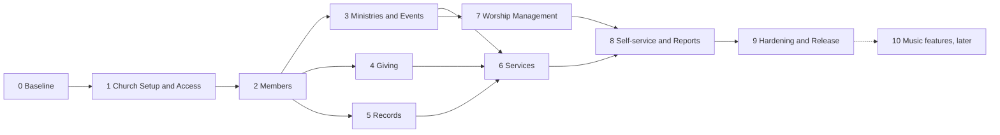

# Development Plan

The build order for the **management side** of CHORD: church setup, people,
calendar, giving, records, services and worship administration. The music
features (ML song recommendation, playback, chord sheet viewer) come after
this plan; [[#Phase 10 (later) Music features|Phase 10]] lists what the
earlier phases must prepare for them.

Tick a task only when its tests and checks pass (see
[[#Definition of done]]). When a phase is finished, update [[00-Home]] and
add a [[Development-Log]] entry.

## Phase order

Each phase builds only on finished phases, so nothing gets built twice.
Shared pieces (module switching, Labels, audit trail, custom fields) come
first so every later module reuses them instead of building its own.

| Phase | Name                     | Size | Depends on |
| ----- | ------------------------ | ---- | ---------- |
| 0     | Engineering baseline     | S    | none       |
| 1     | Church Setup and Access  | L    | 0          |
| 2     | Members                  | M    | 1          |
| 3     | Ministries and Events    | M    | 2          |
| 4     | Giving                   | M    | 2          |
| 5     | Records                  | M    | 2          |
| 6     | Services                 | L    | 3, 4, 5    |
| 7     | Worship Management       | M    | 3          |
| 8     | Self-service and Reports | M    | 6, 7       |
| 9     | Hardening and Release    | M    | 8          |

Sizes are relative (S < M < L). Phases 3, 4 and 5 don't depend on each
other and can go in any order.

> [!note] If the adviser wants to see Services early
> Services is the clearest demonstration of the core rule. To show it
> sooner, build Phase 6 straight after Phase 2 with only the no-fee,
> no-record path, then add the Payment, scheduling and Record steps after
> Phases 3 to 5.

## How each feature is built

Every feature is a **vertical slice**: one complete, usable piece rather
than all models first and all screens later.

1. Read the module note in `03-Modules/` and [[Glossary]]. Settle any new
   term in the glossary first.
2. Write the models and migration. Decide which parts are church settings
   (core rule check, below).
3. Put the business rules in `apps/<module>/services.py` as plain
   functions, and test them directly. Views stay thin.
4. Build the views and templates with the shared mixins (module check,
   permission check, audit trail).
5. Write tests: rules, permissions (allowed and denied), and the
   module-off case.
6. Run the checks script, then update the vault.

### Core rule check (every slice)

From [[0001-configure-behavior-not-identity]]:

- Anything that differs between churches is a setting or a church-edited
  list with neutral defaults.
- Code branches only on settings.
- An unused optional step disappears from both the screens and the
  statuses.
- Wording that differs between churches comes from Labels.
- Denomination, tradition and religion are absent from models, forms, seed
  data and UI text. A guard test enforces this (Phase 0).

### Definition of done

- [ ] `scripts/check.ps1` passes: Ruff lint and format, `manage.py check`,
  no missing migrations, all tests.
- [ ] Permission tests cover every new view, for both allowed and denied
  users.
- [ ] Switching off the module hides it and returns 404 for its pages,
  without losing data.
- [ ] Changes to sensitive data (members, giving, records, requests) are in
  the audit trail.
- [ ] The vault is updated: module note, [[00-Home]] status, and a
  [[Development-Log]] entry.

## Conventions (decided in Phase 0 and 1)

| Topic           | Convention                                                                                               |
| --------------- | -------------------------------------------------------------------------------------------------------- |
| App layout      | One Django app per Module in `apps/`; shared code in `apps/core`.                                        |
| Shared models   | `TimeStampedModel` (created/updated) and `PublicIdModel` (UUID used in URLs, so IDs can't be guessed).   |
| Business rules  | `services.py` functions; Service Request steps in `apps/services/workflow.py`.                           |
| UI              | Server-rendered Django templates, Bootstrap 5 and HTMX, stored in `static/vendor/` (no Node build step). |
| Lists           | Paginated, searchable, filterable through one shared list mixin.                                         |
| Deleting        | Members, giving, records and requests are archived or reversed, never hard-deleted.                      |
| Money           | `DecimalField`; currency set in the Church Profile (default PHP).                                        |
| Files           | Uploads go to private media and are served only through permission-checked views.                        |
| Tests           | Django test runner; `apps/<module>/tests/`; shared test-data builders in `apps/core/testing.py`.         |

## Phase 0: Engineering baseline

Goal: a safe, repeatable project setup before any features are built.

- [ ] Initialise Git, confirm that `.env` is ignored, and make the first
  commit.
- [ ] Create `apps/core` with `TimeStampedModel`, `PublicIdModel` and
  test-data builders.
- [ ] Add the base template: page layout, navigation area, messages and
  form styling. Bootstrap 5 and HTMX are stored in `static/vendor/`.
  Record the UI choice as decision 0002.
- [ ] Add `scripts/check.ps1`, which runs every check in
  [[Environment-Setup]].
- [ ] Add `coverage` to `requirements.txt`.
- [ ] Add the **denomination-free guard test**, which fails if
  "denomination", "tradition" or "religion" appears in models, forms,
  templates, fixtures or seed data.

**Done when** the checks script passes and a signed-in user sees the empty
base page.

## Phase 1: Church Setup and Access

Goal: the configuration layer that every later module relies on.

**Church Profile** (exactly one per installation)

- [ ] Name, address, contact details, logo, currency and time zone.
- [ ] Settings screen for administrators.

**Modules**

- [ ] A module registry in code: code, name, URL namespace and nav entry
  for each Module.
- [ ] On/off settings stored on the Church Profile.
- [ ] A `ModuleRequiredMixin` (returns 404 when off) and a navigation
  context processor that shows only the modules switched on.
- [ ] Tests showing that switching a module off hides it and keeps its
  data.

**Labels**

- [ ] Label keys with neutral defaults (officiant, service, offering,
  member, ministry, worship service), which the church can rename.
- [ ] A `` template tag and a Python helper.

**Accounts and Roles**

- [ ] Sign in and out, change and reset password (console email backend in
  development), own profile.
- [ ] Roles built on Django groups. Seed editable default roles:
  Administrator, Office Staff, Finance, Records Keeper, Worship Leader,
  Ministry Leader.
- [ ] A permission matrix screen for editing what each role may do.
- [ ] User management: create, deactivate and assign roles.

**Audit trail**

- [ ] A shared `AuditEvent` (actor, object, action, changed fields, time)
  and a `record_change()` helper. Every module uses it, so none needs its
  own audit table.
- [ ] An audit log screen for administrators.

**First-run setup wizard**

- [ ] Steps: church details, then Labels, then Modules. It never asks for
  a denomination. The Services step (Starter Catalog) is added in Phase 6.

**Dashboard shell**

- [ ] A home page with one card per enabled module.

**Done when** a new installation can be set up through the wizard, and
tests cover module switching, Labels and role permissions.

## Phase 2: Members

Goal: the people directory that Giving, Records, Events and Services all
refer to.

- [ ] **Custom fields** in `apps/core`: church-defined extra fields (text,
  number, date, choice, yes/no, file). Built once here and reused by
  Services and Records.
- [ ] **Membership Status**: a church-edited list. Defaults: Member,
  Regular Attendee, Visitor, Inactive, Moved Away, Deceased.
- [ ] **Member**: name, sex (optional), birth date, contact details,
  address, photo, date joined, status, custom fields, and an optional link
  to a user account.
- [ ] **Household**: grouping of members with church-edited relationship
  types (defaults: Head, Spouse, Child, Other).
- [ ] List with search, filters and pagination; detail, create, edit and
  archive screens.
- [ ] CSV import with a preview step and error report, and CSV export.
  Import matters because churches start with existing lists.
- [ ] Privacy: birth date, contact details and address are visible only
  with permission. A member with a linked account can view their own
  record.
- [ ] Audit trail on every change.

**Done when** a church can import its members and the privacy rules are
tested.

## Phase 3: Ministries and Events

Goal: groups and a shared church calendar. Services scheduling and Worship
plans both use the calendar.

**Ministries**

- [ ] Ministry, plus ministry membership with church-edited ministry roles
  (defaults: Leader, Member).

**Calendar**

- [ ] **Event Type**: a church-edited list. Defaults: Worship Service,
  Meeting, Fellowship, Outreach, Rehearsal, Other.
- [ ] **Venue**: church rooms and places, used for conflict checks.
- [ ] **Event**: time, venue, ministry, visibility and status. Simple
  recurrence (weekly or monthly) for regular gatherings.
- [ ] **Season**: named date ranges the church defines, with a colour. A
  church defines none by default, and its calendar is then a plain
  calendar.
- [ ] Month, week and list views, and a venue conflict warning.

**Attendance**

- [ ] Optional registration with capacity and a deadline.
- [ ] Two ways to record attendance, chosen per Event Type: per person, or
  a headcount only.

**Done when** recurring events, conflict detection and both attendance
methods are tested.

## Phase 4: Giving

Goal: an accurate record of money given, with corrections that can be
traced.

- [ ] **Fund**: a church-edited list (default: General Fund).
- [ ] **Payment Method**: a church-edited list. Defaults: Cash, Check,
  Bank Transfer, E-wallet, Other.
- [ ] **Contribution**: a member, a named guest or anonymous; fund,
  amount, date, method and reference.
- [ ] **Batch entry** for recording a collection quickly, with batch
  totals checked against the counted amount.
- [ ] Corrections are made with reversing entries, never edits or deletion.
  Every change is audited.
- [ ] Printable receipts and member giving statements for a chosen period.
- [ ] Reports by fund and period, with CSV export.
- [ ] The UI uses the "offering" Label.

**Done when** totals reconcile in tests, including reversals.

## Phase 5: Records

Goal: the church's official registers and certificates.

- [ ] **Record Type**: church-defined, with its own custom fields,
  register numbering (book, page and entry, or none), and certificate
  wording with placeholders. Neutral starter types: Baptism/Christening,
  Child Dedication, Marriage, Funeral/Burial, Membership.
- [ ] **Church Record**: the people involved (members or non-members),
  date, place, officiant (Label), custom field values and register number.
- [ ] A printable certificate page (print CSS, saved as PDF from the
  browser).
- [ ] A log of issued certificates.
- [ ] Restricted access. Corrections are audited, and earlier values stay
  visible.

**Done when** each starter Record Type can be recorded and printed, and
access rules are tested.

## Phase 6: Services

Goal: the Service Request workflow, where configurable church practice
matters most. Design: [[Services]].

**Service Types**

- [ ] **Service Type**: Fee Mode (none, fixed, donation, per request),
  whether the fee can be waived, approval needed, minimum notice,
  officiant needed, Record Type produced (optional), venue needed, whether
  it can be requested online, and custom fields.
- [ ] **Requirements** for each Service Type: name, description, and
  whether a file upload is needed.
- [ ] **Starter Catalog**: copy sample Service Types (no fees, few
  Requirements), then edit them. Added as a step in the setup wizard.

**Workflow**

- [ ] `workflow.py`: `steps_for(service_type)` and the allowed moves
  between statuses, written as plain functions. Tests cover every
  combination of Fee Mode, approval and record.
- [ ] **Service Request** intake: the requester (a member, or a
  non-member's contact details), the people involved, preferred dates and
  custom fields.
- [ ] A Requirements checklist with uploads and a staff check.
- [ ] Payment step: amount by Fee Mode, waiver with a reason, and receipt.
- [ ] Approval step, done by roles with the approve permission.
- [ ] Scheduling: officiant, venue and time, with conflict checks against
  the calendar and other requests. Scheduling creates a calendar Event.
- [ ] Completion, then an optional Church Record pre-filled from the
  request.
- [ ] Cancellation and decline, each with a reason.

**Screens**

- [ ] A request queue grouped by status, and a request detail page with a
  panel for each step.

**Done when** the combination tests pass, and a church with no fees and no
approval sees no payment or approval screens or statuses.

## Phase 7: Worship Management

Goal: song library and worship planning data. Playback, chord sheets and
recommendations are not part of this phase.

- [ ] **Song**: title, authors, language, default key, tempo, time
  signature, themes (a church-edited tag list), Bible references, lyrics
  (optional), external links and licence reference.
- [ ] **Song Slot**: a church-edited list of the places in a service where
  songs are sung. Neutral defaults: Opening, Praise, Response, Offering,
  Closing.
- [ ] **Worship Plan** for a worship-service Event: an ordered list of
  items (songs in slots, readings, other parts) and the people assigned to
  them.
- [ ] **Teams** (choir, band or any church-defined group): members with
  church-edited parts (voice part or instrument), service assignments, and
  rehearsals as calendar Events with attendance.
- [ ] **Song Usage**: written automatically when a plan is finalised.
  Records the song, date, slot, Season, Event Type and team. This is the
  data the later recommendation model learns from.

**Done when** finalising a plan writes Song Usage rows, and plans are
tested.

## Phase 8: Self-service and Reports

Goal: let members do common tasks themselves, and give leaders an overview.

- [ ] **Member portal**: own profile and household, own giving statement,
  event registration, and service requests for Service Types marked as
  requestable online, including requirement uploads and request status.
- [ ] **Notifications**: email and in-app messages for request status
  changes, upcoming schedules and assignments. The church can edit the
  wording.
- [ ] **Dashboard**: figures for each enabled module, such as pending
  requests, this month's giving, attendance trend and upcoming events.
- [ ] **Reports** with CSV export for each module.
- [ ] **Announcements**: church-wide, or for one ministry or team.

**Done when** a member account can complete a service request end to end,
and portal permission tests pass.

## Phase 9: Hardening and Release

Goal: ready for real churches and for thesis evaluation.

- [ ] Security review:
  - a permission test for every view;
  - upload type and size checks;
  - private media;
  - limits on repeated failed sign-ins;
  - production settings (`manage.py check --deploy` clean).
- [ ] Performance: check database query counts on list pages, and add
  indexes and pagination where needed.
- [ ] Mobile layout and basic accessibility pass.
- [ ] A `seed_demo` command with several fictional church configurations,
  for example one that charges fees and requires approval, and one with no
  fees and no records. This shows that one codebase serves different
  practices.
- [ ] A backup and restore script (`pg_dump`) and a deployment guide in the
  vault.
- [ ] User acceptance testing with churches that work differently, using
  the evaluation instrument the thesis requires.

## Phase 10 (later): Music features

Out of scope for now: ML song recommendation, audio playback and the chord
sheet viewer. The management phases already prepare for them:

- Song metadata (key, tempo, themes, language, Bible references) and
  **Song Usage** history, which together are the model's training data
  (Phase 7).
- Seasons and Event Types as context for recommendations (Phase 3).
- Private file storage and permission-checked serving, reused for audio
  and chord sheet files (Phases 0 and 6).

## Decisions to make before their phase

| Phase | Decision                                                                                   | Current leaning                                                                                                                                                     |
| ----- | ------------------------------------------------------------------------------------------ | ------------------------------------------------------------------------------------------------------------------------------------------------------------------- |
| 0     | UI stack                                                                                   | Bootstrap 5 and HTMX, no Node build                                                                                                                                 |
| 1     | Fixed or editable roles                                                                    | Editable, with seeded defaults                                                                                                                                      |
| 4/6   | Where service fees are recorded ([[Services]] open question)                               | Service fees are kept in Services, not Giving, because a fee is not a gift. When Giving is on, a fee can be tagged to a Fund so it appears in the church's finance reports. |
| 5/6   | What a record issued by a Service Request contains ([[Services]] open question)            | Its Record Type's fields, pre-filled from the request                                                                                                               |
| 6     | Whether non-members can request services                                                   | Yes, by giving contact details; no account needed                                                                                                                   |

Record each decision in `02-Architecture/Decisions/` once it is made.
