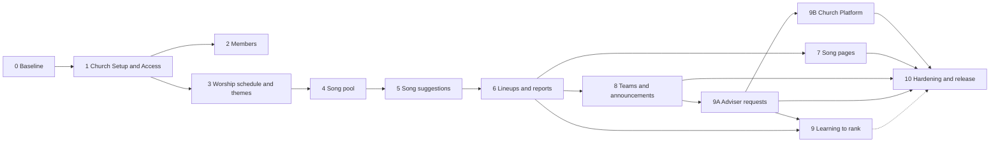

# Development Plan

The build order for CHORD as a worship planning system, following the
[[Concept-Brief]] ([[0005-worship-planning-scope]]). Phases 0 to 2 built
the foundation under the earlier church-administration plan; from Phase 3
on, every phase builds part of the brief.

Tick a task only when its tests and checks pass (see
[[#Definition of done]]). When a phase is finished, update [[00-Home]] and
add a [[Development-Log]] entry.

## Phase order

Each phase builds only on finished phases, so nothing gets built twice.

| Phase | Name                          | Size | Depends on | Status            |
| ----- | ----------------------------- | ---- | ---------- | ----------------- |
| 0     | Engineering baseline          | S    | none       | Done (2026-11-15) |
| 1     | Church Setup and Access       | L    | 0          | Done (2026-11-16) |
| 2     | Members                       | M    | 1          | Done (2026-11-16) |
| 3     | Worship schedule and themes   | M    | 1          | Done (2026-11-17) |
| 4     | Song pool                     | M    | 3          | Done (2026-11-17) |
| 5     | Song suggestions              | L    | 4          | Done (2026-11-18) |
| 6     | Lineups and reports           | L    | 5          | Done (2026-11-19) |
| 7     | Song pages: chords and playback | L  | 6          | Done (2026-11-22) |
| 8     | Teams and announcements       | M    | 6          | Done (2026-11-23) |
| 9A    | Adviser requests (24 Nov)     | L    | 8          | Paused for 9B (A1–A5 done) |
| 9B    | Church Platform (multi-church) | L   | 9A (A1–A5) | Done (2026-11-26), not merged into `master` yet |
| 9     | Learning to rank              | S    | 6, after 9A | Not started (only if time remains) |
| 10    | Hardening and release         | M    | 7, 8, 9A, 9B (9 if built) | Not started   |

This **Status** column is the record of phase progress. Statuses: Done
(with date), In progress, Next, Not started. Sizes are relative
(S < M < L). Phase 9A comes before Phase 9 by the owner's choice
(2026-11-24; the exception is recorded in `AGENTS.md`), and Phase 9 is
built only if time remains before the final presentation (1–4 Dec 2026).
Phase 9B, the Church Platform, comes before the rest of 9A (owner,
2026-11-25; [[0014-church-platform]]).

Out of scope since [[0005-worship-planning-scope]]: Giving, Records,
the old Services design (fees, requirements, records), Ministries, Events,
leadership appointment and ordination, SMS messaging, check-in and
follow-up, and per-person attendance (on hold since the adviser asked for
it on 2026-11-24). Occasions are back in scope as their own Module ([[0013-occasions-module]]).

Each phase also builds its section of [[Design-Decisions]], with the tests
listed there. Where the two disagree, Design-Decisions wins.

## How each feature is built

Every feature is a **vertical slice**: one complete, usable piece rather
than all models first and all screens later.

1. Read the module note in `03-Modules/` and [[Glossary]]. Settle any new
   term in the glossary first.
2. Write the models and migration. Decide which parts are church settings
   (core rule check, below).
3. Put the business rules in plain functions outside the views, and test
   them directly ([[Code-Conventions]]). Views stay thin.
4. Build the views and templates with the shared mixins (module check,
   permission check, audit trail).
5. Write tests: rules, permissions (allowed and denied), and the
   module-off case.
6. Run the checks script, then update the vault.

### Core rule check (every slice)

From [[0001-configure-behavior-not-identity]]:

- Anything that differs between churches is a setting or a church-edited
  list with neutral defaults.
- Code branches only on settings.
- An unused optional step disappears from both the screens and the
  statuses.
- Wording that differs between churches comes from Labels.
- Denomination, tradition and religion are absent from models, forms, seed
  data and UI text. A guard test enforces this (Phase 0).

### Definition of done

- [ ] `scripts/check.ps1` passes: Ruff lint and format, `manage.py check`,
  no missing migrations, all tests.
- [ ] Permission tests cover every new view, for both allowed and denied
  users.
- [ ] Switching off the module hides it and returns 404 for its pages,
  without losing data.
- [ ] Changes to planning data (services, themes, lineups, songs, teams)
  are in the audit trail.
- [ ] Tests never use the network or download a model: outside services
  and ML models are replaced by stand-ins.
- [ ] The vault is updated: module note, [[00-Home]] status, and a
  [[Development-Log]] entry.

## Conventions

See [[Code-Conventions]]. Update that note whenever a phase settles a
convention.

## Phase 0: Engineering baseline

**Status: done (2026-11-15).**

Goal: a safe, repeatable project setup before any features are built.

- [x] Initialise Git, confirm that `.env` is ignored, and make the first
  commit.
- [x] Create `apps/core` with `TimeStampedModel`, `PublicIdModel` and
  test-data builders.
- [x] Add the base template: page layout, navigation area, messages and
  form styling. Bootstrap 5 and HTMX are stored in `static/vendor/`.
  Record the UI choice as decision 0002.
- [x] Add `scripts/check.ps1`, which runs every check in
  [[Environment-Setup]].
- [x] Add `coverage` to `requirements.txt`.
- [x] Add the **denomination-free guard test**, which fails if
  "denomination", "tradition" or "religion" appears in models, forms,
  templates, fixtures or seed data.

## Phase 1: Church Setup and Access

**Status: done (2026-11-16).** See [[Church-Setup]] and [[Accounts]].

Goal: the configuration layer that every later module relies on.

- [x] **Church Profile** (exactly one per installation): name, address,
  contact details, logo, currency and time zone, with a settings screen.
- [x] **Modules**: a registry in code, on/off settings on the Church
  Profile, `ModuleRequiredMixin` (404 when off), and navigation that shows
  only switched-on Modules.
- [x] **Labels** with neutral defaults, a `` template tag and a
  Python helper.
- [x] **Accounts and Roles**: sign in and out, password change and reset,
  own profile; Roles on Django groups with editable defaults; the
  permission matrix; user management.
- [x] **Audit trail**: a shared `AuditEvent` and `record_change()`, plus
  the audit log screen.
- [x] **Setup wizard**: church details, then Labels, then Modules. It
  never asks for a denomination.
- [x] **Dashboard** with one card per switched-on Module.

## Phase 2: Members

**Status: done (2026-11-16).** See [[Members]].

Goal: the people directory. The brief asks only for a basic one; this is
kept as built.

- [x] Custom Fields in `apps/core`.
- [x] Membership Status and Household Roles as church-edited lists.
- [x] Member and Household, with list, detail, add, edit and archive.
- [x] CSV import with a preview, and CSV export.
- [x] Privacy rules, the own-record page, and the audit trail.

## Phase 3: Worship schedule and themes

**Status: done (2026-11-17).** See [[Worship]].

Goal: the brief's service scheduling and theme intake (pipeline stage 1),
and the scope change itself.

- [x] Re-scope the Module registry, Labels and default roles
  ([[0005-worship-planning-scope]]).
- [x] **Service Template**: a church-edited kind of service with ordered
  **Song Slots**, each with a feel, and an optional usual day and time.
- [x] **Worship Service**: name, template, date and time, rehearsal time,
  notes and a cancelled flag.
- [x] The schedule list (upcoming and past, with search) and a month
  calendar.
- [x] **Schedule weeks ahead**: adds a template's service on its usual day
  for the coming weeks, filling only the gaps.
- [x] **Theme** per service: title, main scripture, notes and an optional
  **Series** (a church-edited list). Notes are shown only to people who
  plan.
- [x] **Attendance**: a headcount per service.
- [x] Default-role permissions, permission tests and the audit trail.

**Done when** a service can be scheduled, given a theme and counted, and
the tests cover weekly scheduling in the church's time zone.

## Phase 4: Song pool

**Status: done (2026-11-17).** See [[Worship]] and
[[0006-onnx-runtime-for-song-analysis]].

Goal: the songs the system knows, and the outside services and models that
describe them (pipeline stages 3, 5 and 6 as reusable pieces).

- [x] **Song** (`apps/songs`): Spotify track ID, title, artist, album and
  length; cached lyrics and their status; the worship check result; feel;
  theme tags; an embedding; "the team knows it".
- [x] **Theme Tag**: a church-edited list of about 30 worship themes with
  neutral defaults. **Trusted Artist**: a church-edited list, empty by
  default.
- [x] A **Spotify client**: app token, track search with paging and the
  genre filter, and error handling. Credentials come from `.env`.
- [x] An **LRCLIB client**: lookup by title, artist, album and length, one
  request at a time, with a fallback search.
- [x] The **ML engine**: sentence embeddings and a zero-shot classifier
  run with ONNX Runtime, plus a keyword stand-in used by every test.
- [x] **Song analysis**: the worship check, tag suggestions, the feel
  guess and the embedding, from lyrics only.
- [x] The song library: list with filters, song page, and editing of tags,
  feel, the worship check and "the team knows it". Also "Find on Spotify"
  to add one track, and `manage.py process_songs`.

**Done when** a song's lyrics can be fetched, analysed and corrected by
hand, and the tests run without the network or model files.

## Phase 5: Song suggestions

**Status: done (2026-11-18).** See [[Worship]] and [[0007-search-worker]].

Goal: from a posted theme to ranked songs (pipeline stages 2 to 9).

- [x] **Suggestion settings** (one row): search genres, phrases per theme,
  pages per phrase, market, the four ranking weights, and the repeat
  window.
- [x] **Season**: church-defined date ranges linked to Theme Tags; none by
  default.
- [x] **Search Run**: phrases used, pages read, songs found, run time,
  progress and status.
- [x] The pipeline: search phrases, Spotify search with the unfiltered
  retry, cleanup, lyric lookups, analysis of new songs, ranking and
  explanations.
- [x] Ranking: `w1·relevance + w2·familiarity + w3·season − w4·recency`
  over every accepted song in the pool.
- [x] Sequencing: the top songs placed in the template's slots by feel.
- [x] The **search worker** (`manage.py run_worker`) and a progress panel
  on the service page.
- [x] A way to try the pipeline without Spotify: ranking the pool alone,
  and a command that seeds public-domain hymns.
- [x] **Raw model score**: `Song.worship_model_score` holds the
  classifier's score, from the lyrics only. The Trusted Artist bonus is a
  church rule applied after the model and stored apart (the adjusted
  `worship_score`), with a code comment that it is never a training
  feature.
- [x] **Suggestions hidden from team members**: the service page's
  suggestion panel and every suggestion URL check `worship.suggest_songs`.
  `suggest_songs` and `view_searchrun` go to Worship Leader and Pastoral
  Staff only.
- [x] **Spotify safeguards** in `apps/songs/spotify.py`: stop on the first
  429; a shared "blocked until" time that the worker and web requests
  check; at most one retry; a Retry-After over an hour or
  `QUOTA_EXCEEDED` pauses Spotify, tells the worship leader and falls back
  to ranking the pool; never re-fetch a pooled track; no
  search-as-you-type; Spotify calls and 429s recorded on each Search Run.
- [x] **One worker**: `run_worker` takes a PostgreSQL advisory lock at
  startup, and a second worker refuses to start. `claim_next_run` stays as
  it is. Documented in `AGENTS.md` and `run_worker.py`.
- [x] Tests for `phrases.py`, `ranking.py`, `sequencing.py`,
  `suggesting.py` and `cleanup.py` (a live-only song is kept; a live
  duplicate of a studio song is dropped; karaoke, instrumental and backing
  tracks are always dropped).
- [x] When the code changes, update [[Worship]],
  [[0006-onnx-runtime-for-song-analysis]] and the [[Glossary]] (Worship
  Check, Trusted Artist), and record the search worker in its own
  decision.

**Done when** a run on a seeded pool produces a ranked, explained set of
songs, a failed outside call ends the run with a clear message, and the
Phase 5 tests in [[Design-Decisions]] pass: the raw score ignores the
Trusted Artist list, a team member sees no suggestions, every Spotify
safeguard holds, and a second worker refuses to start.

### Phase 5 follow-up: smoke test fixes (done 2026-11-18)

From the first live smoke test ([[Design-Decisions]], Phase 5 follow-up):

- [x] Match labels and relevance on a fixed scale (the engine's
  `similarity_range`), with "doesn't match the theme well"; default weights
  recalibrated (familiarity 0.2, season 0.15, recent use 0.3).
- [x] A hint in the suggestions panel when the theme has no notes.
- [x] Feel: placement with a feel mismatch weight (a church setting,
  default 0.15); feel left blank when the analysis isn't sure; one-click
  feel correction in the panel, kept when the song is analysed again.
- [x] Worship check: the pass mark as a church setting; the optional rule
  for artists not on the Trusted Artists list (off by default); one-click
  "Not a worship song"; each search's genre-filter result recorded for
  information only.
- [x] Versions of one song grouped, one kept; one title once per lineup.
- [x] `seed_hymns`: 23 public-domain hymns, with Christmas carols, slow
  hymns and Easter hymns.
- [x] Theme tags: measured; the neutral-class fix can't apply to this model,
  and none of the other options beat today's rule, which stays.

## Phase 6: Lineups and reports

**Status: done (2026-11-19).** See [[Worship]] and
[[0008-final-say-permission]].

Goal: review, confirmation and what follows from it (pipeline stage 10 and
the data for stage 11).

- [x] **Lineup** and **Lineup Item**: slot, order, service key, notes, the
  reason it was suggested, and a lock on a song (kept in place when the
  lineup is regenerated). A lineup is a draft or confirmed; there is no
  other state.
- [x] Review: swap from ranked alternatives, lock, reorder, remove, add
  from the pool, regenerate around locked songs.
- [x] **Final say** ([[0008-final-say-permission]]): the permission
  `worship.finalize_lineup`, held by Pastoral Staff by default and by the
  Administrator, like every permission. Code checks the permission, never a
  role name. A new church Label, `pastor` (default "Pastor").
- [x] Confirmation: the worship leader or the pastor (a holder of
  `worship.finalize_lineup`) confirms.
  - the pastor's edits to a draft don't lock the worship leader out;
  - the **pastor's lock** starts when the pastor confirms a lineup, or
    edits one that is already confirmed, and lasts until the pastor
    reopens it. It stops only people without the permission;
  - if the pastor edits a confirmed lineup, it stays confirmed and is
    marked "Edited by <pastor Label> (<person's name>)" with the time,
    shown to everyone who can see it. No notifications in this phase (they
    come in Phase 8);
  - reopening makes the lineup a draft again and lifts the pastor's lock;
  - only the pastor can send a lineup back: it returns to draft with a note
    for the worship leader. It adds no state; sending back a confirmed
    lineup reopens it.
- [x] The team sees a lineup only once it is confirmed. While a lineup
  that was confirmed is a draft again, they see a note that it is being
  revised.
- [x] No suggestions and no new lineup for a cancelled or past service
  (workflow review F7).
- [x] **Suggestion Feedback**: every kept, swapped and removed suggestion.
- [x] Usage: `ranking.song_usage()` reads confirmed lineups, so
  familiarity and recency start counting. Usage is computed, not stored.
- [x] Reports: song usage with CSV export, highlighting songs used more
  often than the recent-use window allows (the repeat window); no separate
  overused-songs report. Attendance (a headcount per service).

**Done when** the usage report matches the confirmed lineups and
highlights a song sung again within the repeat window, and these are tested
for every role:
- the leader can confirm, and so can the pastor;
- the pastor's edits to a draft don't lock the leader out;
- the pastor's confirmation, or edit to a confirmed lineup, locks the
  leader out;
- that edit keeps the lineup confirmed and shows "Edited by <pastor Label>
  (<person's name>)" with its time;
- reopening lifts the lock, and team members then see the "being revised"
  note, not the songs;
- sending back returns the lineup to draft with its note, and only the
  pastor can do it;
- the final say follows `worship.finalize_lineup`, not the role;
- a team member can't see an unconfirmed lineup, by page or by URL.

## Phase 7: Song pages: chords and playback

Goal: one page per lineup song with the track, the chords and the key.
The rules and tests for this phase are in [[Design-Decisions]] (Phase 7).

- [x] **Chord Sheet** in ChordPro, typed or pasted; Ultimate Guitar-style
  text (chords over words) is converted to ChordPro on the server, in
  Python (not ChordSheetJS, which is GPL-2.0-only). The server checks that
  the saved text is valid ChordPro. Only the original ChordPro text and its
  key are stored.
- [x] **Import a ChordPro file** on the chord sheet form (.cho, .chopro,
  .chordpro, .pro or .txt, up to 200 KB, UTF-8): its text goes into the
  box to check, and the key comes from its `{key:}` or `{k:}` line. The
  file isn't stored. Rhythm lines such as `|D//G|////|` transpose. A
  person still brings in each chart; nothing is fetched from any site.
- [x] **Find chords**: a song without a sheet shows an action that opens a
  search on free sources such as Worship Together and Ultimate Guitar, in
  a new tab. Nothing is fetched or scraped; the chart is pasted by hand.
- [x] Each lineup shows how many of its songs have a chord sheet.
- [x] When sheets can be added: at any time, for any song in the pool, so
  the worship leader can add one ahead of time. A sheet is required only
  once the song is in a confirmed lineup.
- [x] Approval: a sheet added by the worship leader or the pastor is
  approved at once. A team member may paste a sheet for a song in a
  confirmed lineup; it is saved as pending, other team members can't see
  it, and the worship leader or the pastor approves it. Approving is a
  permission the Worship Leader and Pastoral Staff roles hold, not a check
  on a role name.
- [x] The viewer, transposed **on the server** in Python
  ([[0009-transposition-on-the-server]]): the sheet in the service key, a
  personal transpose, a capo view and Nashville numbers. Changing the key
  re-renders the sheet with htmx.
- [x] A practise-along toggle that shows the chords in the recording's
  key, since Spotify audio can't be pitch-shifted. The **recording's key**
  is entered by a person on the song (Spotify gives none); without it, the
  toggle is hidden.
- [x] Key tools: transpose by semitone or to a key, capo positions, and
  **the keys the song was sung in**: its service keys in confirmed
  lineups, most recent first, shown when choosing a lineup song's key.
- [x] Lyrics on the song page only for people who plan, through a
  permission held by Worship Leader and Pastoral Staff (workflow review
  F13). Team members see the words through the chord sheet.
- [x] **Spotify connection** per user (Authorization Code flow), with
  tokens refreshed as needed. Access and refresh tokens are stored
  **encrypted** with Fernet from `cryptography`, with the key in `.env`
  (`SPOTIFY_TOKEN_KEY`); add `cryptography` to `requirements.txt` and the
  key to `.env.example`. Tokens are never shown or logged, encrypted or
  not.
- [x] Playback: the Web Playback SDK for connected Premium accounts, the
  embedded player or an "Open in Spotify" link otherwise. An SDK call that
  gets a 429 shows a short message and falls back to the embedded player
  or the link, with no automatic retry.
- [x] On confirmation, the lineup is saved automatically as a Spotify
  playlist on the worship leader's account. With no Spotify connection, or
  on a 429, it is skipped, the lineup stays confirmed, and a "Save to
  Spotify" button lets the leader try again later.
- [x] The Phase 5 Spotify safeguards cover every server-side Spotify call
  this phase adds, such as creating the playlist.
- [x] No web request waits on a Spotify Retry-After (workflow review F10):
  saving the playlist, Find on Spotify and any other call made during a
  web request fail fast on a 429. The playlist then shows "Save to
  Spotify".

**Done when** the viewer's transposing is tested in the normal test suite
(so `scripts/check.ps1` checks it), and playback falls back to the embedded
player whenever the SDK can't be used. Also tested: a team
member's paste is pending; the worship leader or the pastor can approve
it; other team members can't see a pending sheet; a stored token is not
the plain token, and decrypts back to it; confirming saves the playlist
for a connected leader, and without a connection or on a 429 the lineup
is still confirmed and the "Save to Spotify" button shows, without waiting;
a song's keys are listed from confirmed lineups, most recent first; the
practise-along toggle is hidden without a recording key; invalid ChordPro
is refused; team members don't see full lyrics on the song page.

## Phase 8: Teams and announcements

**Status: done (2026-11-23).** See [[Teams]] and [[Announcements]].

Goal: who serves when, and notes to them. Decisions: [[Design-Decisions]],
Phase 8 (2026-11-23).

Part A: roster and availability (built 2026-11-23).

- [x] **Team Part**: a church-edited list (voice or instrument).
- [x] **Team Profile**: a user's parts (no vocal range).
- [x] **Assignment**: who does which part at a service, with the person's
  reply (Pending, Accepted, Declined).
- [x] **Blackout Dates**, and "My schedule".
- [x] Updating a stored Lineup Playlist: a new one only on a 404, or a 403
  from a playlist the connected account doesn't own.

Part B: swaps, announcements and notifications (built 2026-11-23).

- [x] The team is a permission: only holders of `teams.view_assignment`
  have a Team Profile or Blackout Dates, are offered in Assign, or take a
  swap.
- [x] **Swap Request**: ask to be replaced and withdraw while open; the
  first eligible person takes it, as Accepted, under a row lock.
- [x] **Announcements** to everyone or to one service's team.
- [x] In-app notifications (no email or SMS) to a service's Pending and
  Accepted assigned people, never the person who caused them: the pastor
  edits a confirmed lineup, anyone else edits a confirmed lineup, the
  lineup is confirmed; and to a person when they are assigned. Nothing for
  cancelled or past services. An unread count in the navigation, and
  marking read.

**Done when** nobody can be assigned on a blackout date, without the part
or without the team permission; a swap moves the assignment to the first
eligible taker as Accepted, and a second taker at the same moment is
refused; each of the pastor's edit, another person's edit and the
confirmation of a lineup notifies that service's Pending and Accepted
assigned people and nobody else (not Declined ones, not the person who
caused it, nothing for a cancelled or past service or a draft); a newly
assigned person is notified; and an announcement to one service's team
reaches only that team.

## Phase 9A: Adviser requests (24 Nov)

**Status: paused for Phase 9B (A1 to A5 done 2026-11-24 and merged into
`master`).** A6 and A7 continue after 9B. The rules and tests are in
[[Design-Decisions]], "Adviser comments, 24 Nov"; more comments or changes
may come. Nothing is merged into `master` until the owner says so.

Goal: what the adviser asked for on 2026-11-24, each in its smallest useful
form. Order: A1 to A3 (small), then A4, A5 and A6; the A7 wireframes are
drawn alongside, for the owner's review.

- [x] **A1 Church Member role** (done 2026-11-24): a default role that
  sees the dashboard, its own member record, announcements to everyone and
  the schedule with theme titles (its own Occasion Requests come with A5);
  no lineups, song pages, chord sheets, lyrics or other members. The
  navigation and dashboard list only Modules a person can open, and the
  "Spotify account" link shows only to people who can see lineups.
- [x] **A2 A role change keeps history** (done 2026-11-24): proved by
  tests; a role history on the user's page; when someone leaves the team
  (a change of roles or active status), their coming assignments are
  listed and the admin ends or keeps them.
- [x] **A3 User history** (done 2026-11-24): sign-in, sign-out and failed
  sign-in in the Audit Trail (`SignInEvent`, apart from changes); a History
  page for each user, linked from their edit page.
- [x] **A4 Batch accounts** (done 2026-11-24) from the Members list: a
  chosen role (Church Member by default), linked to the Member record,
  temporary passwords shown once and never stored or logged, changed at
  first sign-in. Administrator only for now (see the decisions below).
- [x] **A5 Occasions** (done 2026-11-24; [[0013-occasions-module]]):
  the [[Occasions]] Module, apart from worship services: Occasion Types
  with a usual length ("Wedding", "Baptism" and "Funeral" seeded switched
  off); Occasions added by the pastor, with who it's for, officiant and
  venue; Occasion Requests (Pending, Approved, Declined, Withdrawn)
  approved with `occasions.approve_occasion`; booked times shared with
  worship services on the calendar ("Booked" for people who may not see
  occasions); overlaps refused; the requester notified. Notifications
  moved out of Teams into a core app first.
- [ ] **A6 Reports**: a filtered Members report with a print layout and
  CSV; age groups as a church-edited list. Ask the owner about "who
  attended a service" first (on hold).
- [ ] **A7 UI pass**: wireframes of the main screens for the owner's
  approval, then button placement and layout; colours later. Part 2, the
  owner's design system and the Spotify player card, built 2026-11-25 on
  branch `ui-design-system` ([[Design-System]]); the per-screen layout
  changes are still to do, when the owner asks.

**Done when** the tests listed for A1 to A7 in [[Design-Decisions]] pass:
a Church Member is refused on lineups, song pages and chord sheets; a
Worship Leader made a Church Member keeps every past record under their
name, and the admin's choice about future assignments holds; sign-ins are
recorded without passwords; batch accounts never store or log a
temporary password; an overlapping Occasion Request or approval is refused,
and only `occasions.approve_occasion` approves; the report's filters, age
groups and private details are right; and every moved action is still
permission-checked.

## Phase 9B: Church Platform (multi-church)

**Status: done (2026-11-26) on `phase-9b-church-platform`; merged into
`master` only when the owner says so, after the click-through.** On branch
`phase-9b-church-platform`; merged into `master` only when the full check,
isolation tests included, passes, so `master` stays presentable. The
design, slices and risks are in [[Phase-9B-Plan]]; the decision is
[[0014-church-platform]].

Goal: one installation serves many churches. Each church registers itself
(name only, never a denomination), has its own data, roles, settings and
Modules, and a public Church Homepage where people can request an
offered Occasion. People can belong to several churches.

- [x] **Docs** (done 2026-11-25): decision 0014, AGENTS.md, this plan, Glossary,
  Design-Decisions, workflow-spec, Project Overview.
- [x] **a. Foundations** (done 2026-11-25): church fields, Membership, Role per church,
  `ChurchRoleBackend`, `CurrentChurchMiddleware`, `seed_church`, test
  builders, the data migration and its test. Nothing changes on screen.
- [x] **b. Scoping** (done 2026-11-25): the worship pipeline, song library, worker,
  Occasions, Announcements (visibility), Notifications, Audit and settings,
  with isolation tests.
- [x] **c. Accounts** (done 2026-11-25): Register a church, Create an
  account, Add an existing account, the church switcher, locked Modules, a
  home page for people with no church. **Must be done before sign-up
  opens** (found in slice a; owner, 2026-11-25):
  - [x] **Set password across churches.** An administrator may set the
    password (and change the username or email) only of an account that
    belongs to no other church; otherwise the person changes their own.
    Without this, one church's administrator could take over an account
    another church relies on, once "Add an existing account" exists.
  - [x] **People with no membership** see no church's pages. Done in slice
    b by the middleware (`church/no_church.html`); slice c replaces that
    page with their home and must keep the test
    (`accounts/tests/test_church_platform.py`, `NoChurchTests`).
- [x] **d. Church profile** (done 2026-11-26): About, directory and upcoming-services
  settings, the setup wizard for new churches, Occasion Types offered
  publicly.
- [x] **e. Public pages** (done 2026-11-26): Directory, Church Homepage,
  Request this service, My requests.
- [ ] **Click-through** ([[Phase-9B-Click-Through]]) and merging into
  `master`: when the owner says so.

If time runs short, drop in this order: upcoming services on the
homepage, directory search, the cross-church My requests page. Slices a
and b are not optional.

**Done when** the tests in [[Design-Decisions]], "Phase 9B", pass: every
existing test still passes; a user in Church A gets 404 on every detail,
edit and action page for Church B's records, and Church B's rows are
missing from every list and form; permissions come only from the roles in
the Current Church; the migration keeps every row and gives each existing
user a Membership with exactly their roles; and the public pages never
show lineups, songs, chord sheets, lyrics, members or teams.

## Phase 9: Learning to rank

**Built only if time remains after Phase 9A** (owner's choice, 2026-11-24).

Goal: pipeline stage 11.

- [ ] A training command that builds pairs from confirmed lineups and
  fits the ranking weights.
- [ ] Learned weights replace the hand-set ones once enough lineups are
  confirmed; the church can switch back.
- [ ] A page showing both sets of weights and what they were trained on.
- [ ] Training features are only lyrics-based scores (embedding
  similarity, `worship_model_score`, tag scores), the church's own data
  (team knows it, usage, season, slot) and feedback labels. Never the
  Spotify artist, title, album, track ID or length, the Trusted Artist
  bonus, or any score that includes it.

**Done when** training on made-up feedback moves the weights the expected
way, too little data leaves the hand-set weights in place, and a test
shows the training feature list holds none of the forbidden fields.

## Phase 10: Hardening and release

Goal: ready for the proposal and for a real church.

- [ ] Security review: a permission test for every view, upload checks,
  limits on repeated failed sign-ins, production settings
  (`manage.py check --deploy` clean).
- [ ] Performance: query counts on list pages and the lineup page.
- [ ] Mobile layout and basic accessibility pass, especially the song
  page. Partly done by Phase 9A A7 (2026-11-25): the dashboard, schedule,
  calendar, service, lineup, lineup song page, Members list and the
  Settings hub stack at 390px, use 44px buttons and label icon-only
  buttons. Left: the other pages.
- [ ] A `seed_demo` command with fictional churches that work differently.
- [ ] A backup and restore script (`pg_dump`) and a deployment guide.
- [ ] User acceptance testing with the evaluation instrument the proposal
  requires.

## Future experiments

Ideas worth measuring later. None is scheduled; build one only once a
phase takes it on.

- **Tempo from LRCLIB's timed lyrics** (smoke test, 2026-11-18). Lyrics say
  little about tempo, so the feel guessed from them is often wrong. LRCLIB's
  synced lyrics carry timestamps, so words or lines per minute could be a
  rough tempo signal. It comes from LRCLIB, not Spotify, so it may be model
  input. To try: keep the synced lyrics' timing when fetching, compute
  words per minute, and compare it with feels people have set.
- **Theme tags against each tag's average** (measured 2026-11-18;
  [[Development-Log]]). Keep a tag only when it scores unusually high for
  that tag, compared with its average over the pool, so a tag that fires
  on almost every song (like Faith) must stand out. On the 23 seeded
  hymns it gave 4.1 tags per song and Faith on 2 of 23 instead of most,
  but it makes a song's tags depend on the rest of the pool (the relative
  problem the fixed relevance scale removed) and gave the Easter hymn
  "Birth of Jesus". Revisit when the pool is larger and its averages are
  steadier.

## Decisions to make before their phase

| Phase | Decision                                                                 | Current leaning                                                                 |
| ----- | ------------------------------------------------------------------------ | ------------------------------------------------------------------------------- |
| 9     | Must the proposal show a trained model? (the brief's open question)      | Build both: the rules pipeline works from day one, and training switches on once enough lineups are confirmed. Since 2026-11-24, Phase 9 is built only if time remains after 9A; worth asking the adviser |
| 9A    | Who attended a service: optional per-person attendance, or who served from Assignments? | On hold; ask the owner before A6 |
| 9A    | Where in-app notifications live when Teams is off (Occasion Requests need them) | Decided 2026-11-24: moved out of Teams into the core `notifications` app |
| 9A    | "Five users or fewer" in the brief, now that church members get accounts | Decided 2026-11-25 ([[0014-church-platform]]): many churches and users; Spotify's 5-user limit applies to Spotify-connected accounts across the platform |
| 9A    | What is shown at Progress Check 2 (25 Nov), and what goes in the Progress Report | The owner decides later |
| 9A    | Should the pastor also create batch accounts? Today only the Administrator holds `accounts.add_user`. Granting it as it is would let the holder give any role, Administrator included (on Add user too) | Waiting on the owner. Suggested: a separate `members.create_accounts` permission for Pastoral Staff that can give only roles without user or settings permissions |
| 9A    | Warn about coming assignments when the team permission is taken from a whole role (matrix) or a role is deleted | Left for now (owner, 2026-11-24); only a change to one user's roles or status warns. Revisit if the adviser asks |

Record each decision in `02-Architecture/Decisions/` once it is made.

Decided since:

- **Spotify's 5-user Development Mode limit** (Phase 10): acceptable. CHORD
  stays in Development Mode, and the limit is noted as a scaling
  constraint ([[Concept-Brief]], 2026-11-18).
